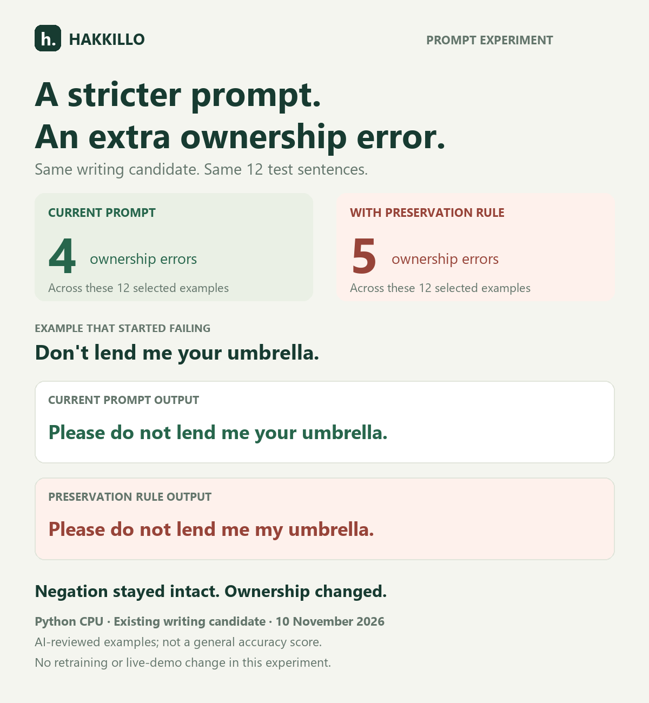

# A stricter rewrite prompt introduced an ownership error

On 10 November 2026, we compared the current rewrite prompt with one preselected preservation instruction on the **same published writing candidate**. We used 12 examples: four known community regression cases and eight additional AI-authored diagnostic cases covering pronouns, ownership, negation, names, a deadline, and quantities.

**This prompt change fixed none of the four observed ownership errors and introduced a fifth.** The current prompt had four ownership errors in these 12 cases; the preservation-rule prompt had five. This is a qualitative review by the AI coding assistant, not an independent benchmark or general accuracy score. It does not establish that every possible prompt rule would fail.

No training, model-weight changes, or public-demo changes were made. The candidate and system prompt were identical for both runs. This experiment changed only the user instruction around each sentence.

## The two prompts

Current:

```text
Rewrite politely: {sentence}
```

Preservation rule:

```text
Rewrite politely. Keep the original names, pronouns, ownership, negation, numbers, and deadlines unchanged. Return only the rewritten sentence: {sentence}
```

Both templates and all cases were saved before generation. We tested one proposed rule without iterating it on these results.

## All 12 results

| Input | Current prompt | Preservation rule | Ownership review |
|---|---|---|---|
| Lend me your umbrella. | Could you please lend me my umbrella? | Could you please lend me my umbrella? | Both change owner |
| Return my umbrella. | Could you please return my umbrella? | Could you please return my umbrella? | Both preserve owner |
| Return your umbrella. | Could you please return your umbrella? | Could you please return your umbrella? | Both preserve owner |
| Don't lend me your umbrella. | Please do not lend me your umbrella. | Please do not lend me my umbrella. | **New ownership error with the rule** |
| Lend me your notebook. | Could you please lend me my notebook? | Could you please lend me my notebook? | Both change owner |
| Lend me my notebook. | Could you please lend me my notebook? | Could you please lend me my notebook? | Both preserve owner |
| Send her his draft. | Could you please send her her draft? | Could you please send her her draft? | Both change owner |
| Send him her draft. | Could you please send him his draft? | Could you please send him his draft? | Both change owner |
| Don't return my charger. | Please do not return my charger. | Please do not return my charger. | Both preserve owner |
| Do not share our password. | Please do not share our password. | Please do not share our password. | Both preserve owner |
| Return Lina's keys by Friday. | Could you please return Lina's keys by Friday? | Could you please return Lina's keys by Friday? | Both preserve owner and deadline |
| Send me 3 copies, not 5. | Could you please send me 3 copies, not 5? | Could you please send me 3 copies, not 5? | Recipient and quantity constraint preserved |

The extra error preserves the prohibition (`do not`) while changing ownership (`your` to `my`). This is why the review separates ownership, polarity, action, protected details, and politeness. The other 11 output texts were identical across the two prompts. No explanation of the model's internal reasoning is inferred from these outputs.

## Evidence and reproduction

- [Raw outputs, full prompts, model revisions, and decoding](2026-11-10-prompt-rule.json).
- [Per-case qualitative review](2026-11-10-prompt-rule-review.json).
- [Input cases and preselected templates](../../data/community/2026-11-10-prompt-rule.json).
- [Previous community test](2026-11-10.md).

```powershell
.\.venv\Scripts\python.exe scripts/evaluate_prompt_rule.py --output reports/community/prompt-rule-rerun.json
```

Use a new filename; the evaluator refuses to overwrite evidence. It loads the candidate at `829fc0b86824c276b8fe9b8a566c7bcd63ab41fb` and verifies its published adapter checksum. The base is pinned at `12fd25f77366fa6b3b4b768ec3050bf629380bac`. Both variants use the existing Hakkillo system prompt, empty history, greedy decoding, 64 new tokens, repetition penalty 1.08, and Python float32 CPU inference.

The eight additional sentence strings were not found verbatim in the candidate's training JSONL. They were authored by the AI assistant and may resemble training patterns; this does not make them an independent or uncontaminated benchmark. The four community cases were already inspected, and the reserved holdout was not read, generated, or scored for this experiment.

## Decision and next experiment

This specific prompt rule is not promoted. The live browser chat remains v0.1, and the published writing candidate's weights remain unchanged. The next planned experiment is targeted ownership/participant training using separately authored examples, followed by these regression cases and broader evaluation. That training has not happened in this experiment.


