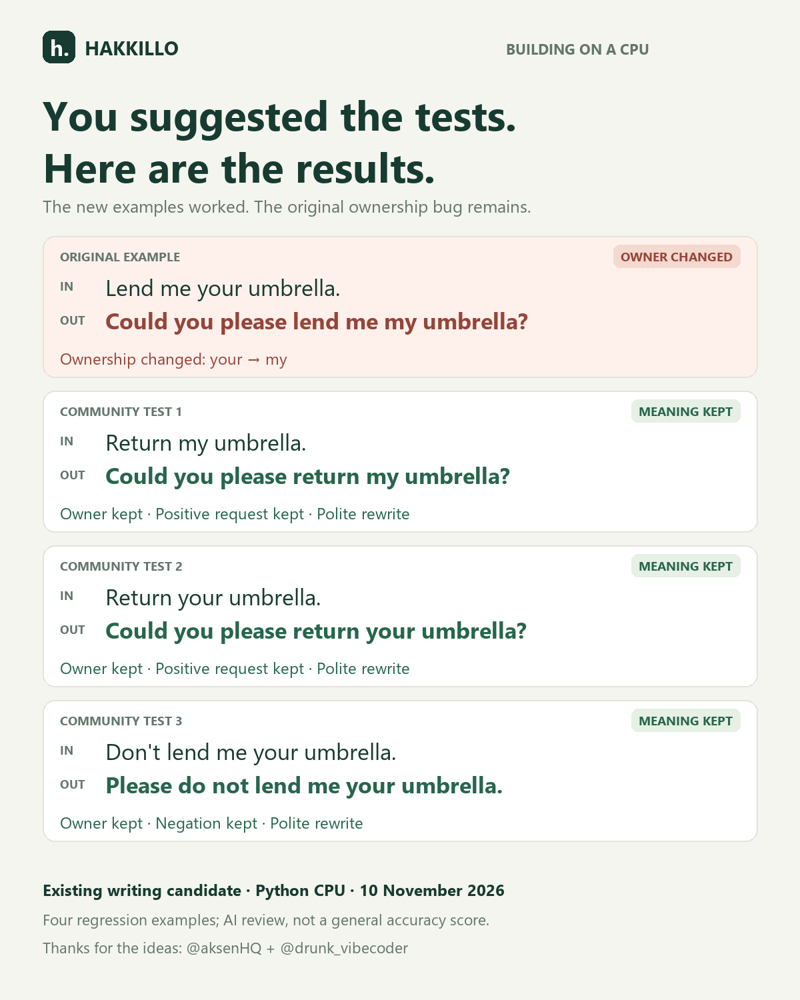

# Community follow-up: ownership and negation

On 10 November 2026, we ran four umbrella rewriting cases against the published v0.1 and writing-candidate1 adapters. Akshat asked how ownership would be preserved; Aliii suggested testing `Return my umbrella.`, `Return your umbrella.`, and `Don't lend me your umbrella.` separately from politeness. Their public replies were supplied by the project owner; source links are recorded in the case file.

**The existing writing candidate preserved ownership and the positive/negative request in all three suggested examples. The original ownership failure still reproduces.** No model training or weight changes were made for this follow-up. These four regression examples are not a general benchmark, and the original case was already inspected during development.

## Actual candidate outputs

Each input was prefixed with `Rewrite politely: ` and sent with an empty conversation history.

| Input | Actual writing-candidate1 output | Ownership | Positive/negative request | Politeness | Action/object |
|---|---|---|---|---|---|
| Lend me your umbrella. | Could you please lend me my umbrella? | **Changed: your → my** | Preserved | Polite rewrite | Lending action and umbrella retained |
| Return my umbrella. | Could you please return my umbrella? | Preserved | Preserved | Polite rewrite | Preserved |
| Return your umbrella. | Could you please return your umbrella? | Preserved | Preserved | Polite rewrite | Preserved; no recipient invented |
| Don't lend me your umbrella. | Please do not lend me your umbrella. | Preserved | **Negation preserved** | Polite rewrite | Preserved |

These judgments are a qualitative review by the AI coding assistant, not independent human evaluation or an automatic semantic score. Acceptable alternatives do not need to match these sentences exactly. For `Return your umbrella`, the check preserves the unusual but supplied request without inventing where the umbrella should go.

The v0.1 Python adapter failed the requested rewrite on all four examples, producing commentary about its abilities and unrelated advice. Its ownership/negation dimensions are not given a passing score merely because its commentary happens to contain a pronoun or negative word. Complete, unedited outputs are in [the JSON report](2026-11-10-umbrella.json).

## Reproduce

With the project's Python dependencies installed, run:

```powershell
.\.venv\Scripts\python.exe scripts/evaluate_community.py --output reports/community/umbrella-rerun.json
```

Use a fresh output filename. Both published adapters and the base model are loaded at recorded commits. The report includes adapter checksums, system prompt, full input/output text, empty history, and decoding settings. It generates no semantic quality score.

- Base: `HuggingFaceTB/SmolLM2-135M-Instruct` at `12fd25f77366fa6b3b4b768ec3050bf629380bac`.
- v0.1 adapter: `72104c6721c23404d71b9285de35727269b4270f`.
- Writing candidate: `829fc0b86824c276b8fe9b8a566c7bcd63ab41fb`.
- Runtime: Python CPU float32; greedy decoding; max 64 new tokens; repetition penalty 1.08.
- The public browser demo still runs quantized v0.1. This report does not measure that browser runtime.
- The reserved holdout was not used. No public feedback or regression case was added to training.

## What this changes

The project now has a reproducible set of community regression cases and separate review criteria for ownership, negation, politeness, and action. A more polite sentence can still fail because it changes the requested meaning.

The next training experiment should use separately authored ownership and negation examples, keep these cases available for regression checking, and test broader sentences after the change. Today establishes the current behavior; it does not establish that the ownership bug is fixed.


