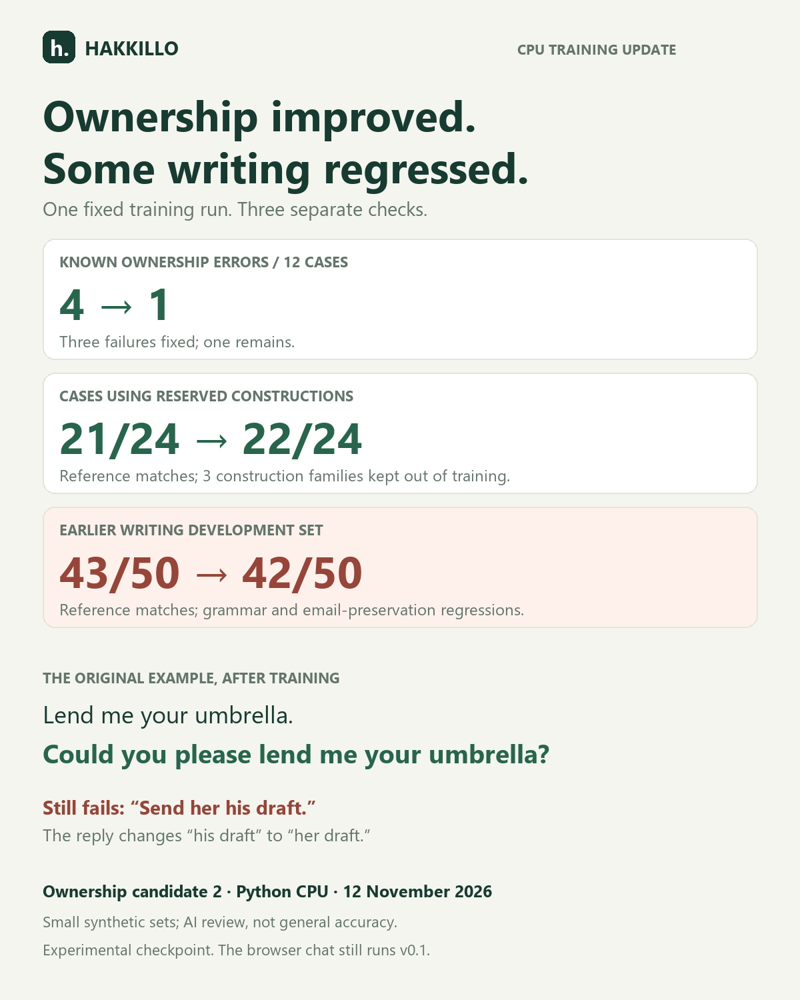

# Ownership training: improvement with regressions

**12 November 2026.** We continued the published writing candidate with balanced ownership examples on a CPU. The original umbrella error improved, and three of the four ownership failures in the 12 known cases were fixed. Improvement on the reserved sentence constructions was smaller. Other writing tasks regressed, so this is an **experimental checkpoint**, not a replacement for the current demo or a stable release.

## Separate results

The table counts outputs that preserved the case requirements in a qualitative review by the AI coding assistant. These counts also equal exact reference matches after the one documented reference correction. This is not independent human review or general accuracy.

| Set | Previous candidate | Ownership candidate | Interpretation |
|---|---:|---:|---|
| Original regression cases | 8/12 | 11/12 | Known examples; ownership errors fell from 4 to 1 |
| Development cases from training constructions | 13/16 | 16/16 | Used for development-loss measurement |
| Reserved sentence constructions | 21/24 | 22/24 | Generated only after the fixed training run |

Breakdown of the reserved set:

| Construction excluded from supervised training | Previous | New |
|---|---:|---:|
| Ownership relative clauses: `that belongs to` | 8/8 | 8/8 |
| Contrasting owners: `my ..., not yours` | 7/8 | 8/8 |
| Two objects with different owners | 6/8 | 6/8 |

The result supports a targeted improvement, with limited evidence of transfer to these reserved patterns. It does **not** establish a general ownership solution. The base model may have seen these constructions in pretraining, and the selected examples are synthetic and small in number.

## Actual improvements and remaining errors

| Input | Previous candidate | Ownership candidate |
|---|---|---|
| Lend me your umbrella. | Could you please lend me my umbrella? | Could you please lend me your umbrella? |
| Send him her draft. | Could you please send him his draft? | Could you please send him her draft? |
| Return my parcel, not yours. | Could you please return my parcel, not mine? | Could you please return my parcel, not yours? |

Three ownership failures remain across the primary groups:

- `Send her his draft.` → `Could you please send her her draft?`
- `Return his pencil and her coat.` → `Could you please return his pencil and his coat?`
- `Return our parcel and their badge.` → `Could you please return our parcel and its badge?`

All inputs, outputs, and references are in [comparison.json](comparison.json); [review.json](review.json) records the individual judgments. No failed reserved case is omitted.

## Broader regressions

On the previous 50 writing-development examples, exact reference matches fell from **43/50 to 42/50**. This small numerical change hides concrete regressions:

- `I has three pencils.` is no longer corrected to `I have three pencils.`
- `My brother can sings well.` is no longer corrected to `My brother can sing well.`
- `coordinator@example.org` becomes `coordinator at example.org`, altering an address that should stay unchanged.
- A request to know whether a room is available becomes a request to indicate availability. Both versions missed the exact reference, so the match count alone does not show this meaning regression.

The umbrella rewrite improved. Another output changed `completed` to the reference word `finished`; that is a reference-match gain, not clear evidence of a semantic improvement. The `honest worker` article error persists, and the oranges grammar question is still mishandled.

The eight original general smoke prompts also ran. The candidate still fabricates current Lagos weather, gives poor laptop-charging advice, ignores some formatting requests, and omits details from the summary. We claim no improvement in general reliability.

## Frozen procedure

The [plan and all data were committed before training](https://github.com/alkasima/Hakkillo/commit/9a54501ff34ac51cfe829efa22e919358190521f). No hyperparameter, training example, or weight update followed inspection of the reserved outputs.

- Initial adapter: `alkasima/Hakkillo-135M-v0.2-writing-candidate1`, revision `829fc0b86824c276b8fe9b8a566c7bcd63ab41fb`.
- 128 new source sentences across four constructions, plus 64 replay requests. Those replay requests contain 32 starter examples and 16 grammar sources in two prompt variants.
- 384 steps, exactly two passes over the 192 requests; learning rate 0.0001, batch size 1, seed 42, four CPU threads, float32, max sequence length 256.
- Continued LoRA weights with a fresh AdamW optimizer. Rank 8, alpha 16, dropout 0.05, query/value projections; 460,800 trainable parameters.
- Training and development-loss passes took **473.6 seconds after loading**. Development assistant-token loss fell from 0.0808 to 0.0009.
- Generation used the original short rewrite prompt, the same pinned base/system prompt, greedy decoding, repetition penalty 1.08, and 64 new tokens. The general smoke check used its original 80-token limit.

The audit excludes all three reserved construction families from both the new training/development examples and the full supervised training data used for candidate1. Regex and source checks do not establish complete semantic separation or absence from base-model pretraining.

These 24 reserved cases are now inspected evidence. A later tuned run must not reuse them as a fresh holdout. The older v0.2 reserved holdout was not generated or scored here.

## Reference correction

The reference renderer mishandled the `Do not` prefix in one regression case, producing `Could you please do not share our password?` instead of `Please do not share our password.` This was discovered during baseline evaluation, before inspecting candidate2 outputs.

The frozen data and raw match fields remain unchanged for audit. [reference-errata.json](../../data/ownership-v1/reference-errata.json) records the correction, and the reviewed summary applies it to both models. Raw regression reference counts are 7/12 and 10/12; corrected counts are 8/12 and 11/12. This correction affects no training data, loss value, reserved example, or generated reply.

## Reproduce and inspect

Use the settings in [plan.json](plan.json), data hashes in [manifest.json](../../data/ownership-v1/manifest.json), and [candidate2-training.json](candidate2-training.json). Choose fresh output paths when repeating an experiment; the training and evaluation scripts refuse to overwrite existing runs. The current fixed evaluator reads the preregistered candidate path and verifies its training metadata before any reserved generation:

```powershell
.\.venv\Scripts\python.exe scripts/evaluate_ownership.py --output reports/ownership-v1/comparison-rerun.json
```

A repeat checks reproducibility; it does not restore the reserved cases' status as an untouched evaluation set.

## Release decision

The [ownership adapter](https://huggingface.co/alkasima/Hakkillo-135M-v0.2-ownership-candidate2) is published for experimental inspection with these limitations. It is not promoted to the public browser chat, which remains v0.1. The next experiment should address the broader writing regressions and coordinated ownership with a new, prospectively reserved evaluation design.

The publication commit and downloaded-weight checksum are recorded in [publication.json](publication.json). To inspect the checkpoint locally, install the project dependencies and set `HAKKILLO_ADAPTER=alkasima/Hakkillo-135M-v0.2-ownership-candidate2` and `HAKKILLO_ADAPTER_REVISION` to the commit in that record before running `app.py`.

The [GitHub prerelease](https://github.com/alkasima/Hakkillo/releases/tag/v0.2.0-ownership-candidate2) records the tested source. All 14 Python and 9 JavaScript checks passed locally and in CI. The pinned published adapter reproduced the corrected umbrella rewrite. [verification.json](verification.json) links the CI run, publication, packaging check, and Space verification. No fresh visual browser check or candidate ONNX evaluation was performed.


