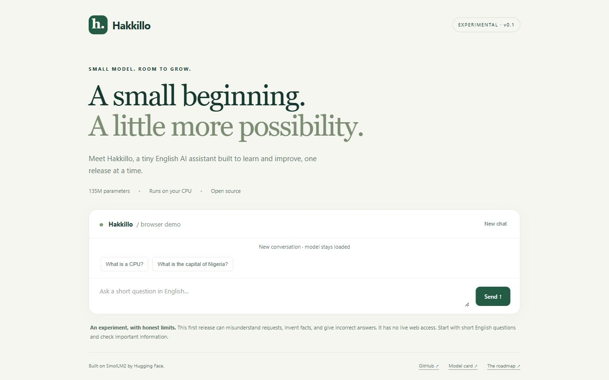

# Release verification

Verified on 2026-11-07 for source commit `04442ab`.

- Local dependency check: passed (`pip check` in `.venv`).
- Training-data tests: 5 passed, including assistant-only labels and separated evaluation prompts.
- CPU training: completed; saved adapter reloaded and generated the eight recorded comparison responses.
- Python Gradio app: loaded locally and answered “What is a CPU?” through the browser.
- ONNX: structural validation and three cached CPU generation checks completed. Quality regressions are documented separately; these checks verify runtime behavior.
- Hosted static Space: reported `RUNNING` and loaded the quantized model in the browser.
- Hosted first prompt “What is a CPU?”: produced a relevant English explanation; UI reported 4.1 seconds.
- Hosted follow-up “Explain that in one short sentence.”: returned a response in 1.7 seconds, although its explanation was weak (“The CPU does all these things it does because of its purpose.”).
- Hosted **New chat**: cleared the conversation and kept the model loaded.
- GitHub automated checks: [successful run](https://github.com/alkasima/Hakkillo/actions/runs/42349820730), including a fresh Linux dependency install and all five training-data tests.
- Source scan found no Hugging Face or GitHub token patterns in files staged for publication. Credentials remain in local credential stores.

Hosted ONNX model revision: `ee52b42d81b3f6ed9cf7dce2a6d93957d03b670c`.
Hosted Space revision: `003df8a4d8febc11935c3a43172111b369b27984`.
Browser library: Transformers.js 3.8.1, WebAssembly CPU in a worker.

These timings describe this one browser test on the current computer; they are not performance guarantees. Passing software checks does not establish answer correctness. Training metrics, output comparisons, and limitations are in the other reports.

